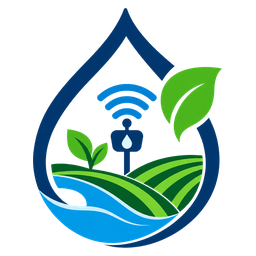

<p align="center">
  
</p>

# JalSaathi (जलसाथी)

**Daily irrigation advice for small farmers, in Hindi and English, using real weather data. No sensors, no login.**

Built by team **Code Hustlers** for **Hack With Delhi 4.0** (Build for Bharat challenge).
Track 7: Climate, Energy and Resource Efficiency. Problem: Monitoring and Reducing Agricultural Water Footprint.

- **Live demo:** https://jalsaathi-nine.vercel.app
- **Code:** https://github.com/Ashutosh-Kumar03/jalsaathi
- **Demo video:** [add link when ready]

## Team Code Hustlers

- Ashutosh Kumar (team leader)
- Vinita Gurjar
- Arpit Singh Chauhan
- Harshit Goyal
- Abhinav Sahu


## The problem

In north-west India, groundwater is being used faster than it is replenished. In the CGWB 2025
assessment, Punjab's stage of groundwater extraction was about 156 percent and Haryana's about 137 percent.
Most of that water goes to irrigation, much of it to rice and wheat.

Many small farmers irrigate by habit (a fixed gap in days, or a permanently flooded paddy field)
without knowing that week's real crop water need or whether rain is coming. That wastes water, diesel or
electricity, and money. Sensor-based solutions exist, but they need hardware that has to be bought,
installed and maintained, so they reach only a few farms.

## Who it is for

A small farmer growing **wheat or rice** who wants one clear answer each morning: *water today, or not?*

## What it does

1. The farmer picks the field location (search by name, or GPS with the place name shown), crop, soil
   type, sowing date and field size.
2. The app fetches real weather data for that exact location (past 30 days and next 7 days).
3. It runs a daily soil-water balance and answers:
   - **Water today / Do not water (rain is coming) / No watering needed**, with millimetres and litres
   - The next irrigation date, a 7-day plan, and in-app alerts (irrigation, rain, crop-stage change)
4. A savings screen compares the advice with the farmer's own habit, in litres, and, if the farmer
   enters pump hours and cost, in pump hours and rupees.
5. A Field tab keeps a log of the days the farmer recorded watering (including earlier dates added
   by hand) and shows how many days matched the app's advice. Only the most recent watering date
   feeds the advice engine. Nothing is guessed or filled in.

Hindi and English, mobile-first, large buttons, works in a phone browser and can be added to the home screen.

## What is different from what already exists

- **Zero hardware:** no sensor to buy, install or maintain.
- **Field-specific and day-by-day:** uses the farmer's own location, crop, soil and sowing date.
- **Rain-aware:** tells the farmer to hold the water when enough rain is forecast.
- **Stage-aware:** crop coefficients and root depth change with the growth stage.
- **Speaks the advice:** a Listen button reads the advice aloud in Hindi or English, for farmers who
  find reading hard. It uses the device's built-in voice, so quality depends on the phone.
- **Works with patchy connectivity:** the app shell and the last weather data are saved on the device.
  Offline, it still shows advice from the saved data and says clearly when that data was last updated.
- **Savings in rupees and pump hours:** computed from the pump hours and cost the farmer enters,
  because farmers think in diesel and electricity bills, not litres.
- **Built for Bharat:** Hindi first, simple screens, low data use.

## How the advice is calculated

- **Weather:** [Open-Meteo](https://open-meteo.com/) daily rainfall and reference evapotranspiration (ET0).
- **Wheat:** FAO-56 method. Crop water use = ET0 x crop coefficient (Kc) for the growth stage.
  A root-zone water balance triggers irrigation once the soil is depleted past the allowed fraction.
  A dedicated irrigation is advised around the crown root initiation (CRI) stage, 20 to 25 days after sowing.
- **Rice:** a simplified alternate wetting and drying (AWD) rule. The field stays flooded at the sensitive
  stages and is allowed to dry down in between.
- **Rain:** only rain of 2 mm or more counts, and 80 percent of it is treated as effective.
- **Savings in litres:** the same weather is replayed from the sowing date, and the water used by our rule
  is compared with the farmer's stated habit. Irrigation efficiency is assumed to be 70 percent.
- **Savings in pump hours and rupees:** pump flow = water of one irrigation divided by the pump hours the
  farmer enters. Hours saved = litres saved divided by that flow. Rupees = hours saved x the hourly cost
  the farmer enters. For rice, one irrigation is taken as 50 mm.

## Assumptions and limitations (please read)

- Every figure is an **estimate**. This is decision support, not a measurement.
- Crop coefficients, root depths, soil water capacities and thresholds use standard FAO ranges and simplifications.
  They have **not been validated in a field trial**.
- Our AWD thresholds are simplified. They differ from the day-by-day practice that agricultural universities
  recommend, and must be calibrated with PAU or HAU guidance before real use.
- The wheat CRI timing comes from standard agronomy practice and should be confirmed with a local
  Krishi Vigyan Kendra (KVK).
- Weather comes from a gridded model, not from the farmer's own field.
- The savings figures depend on the habit, pump hours and cost the farmer types in. They compare against
  what the farmer says they do, not against a measured baseline.
- Alerts appear inside the app and can be read aloud. SMS or WhatsApp delivery is not built yet,
  because it needs a paid messaging gateway.
- Voice depends on the voices installed on the device. If no voice for the chosen language is installed,
  the Listen button is hidden and a short note is shown.
- Offline mode needs the site to have been opened once with internet. Saved weather older than the
  forecast window cannot be used.
- No login. Field data is stored only in the browser (localStorage) on the farmer's device.
- Place names for GPS locations come from OpenStreetMap Nominatim (© OpenStreetMap contributors, ODbL).
  When the GPS button is used, the coordinates are sent to that service to get the name.
- Only wheat and rice are supported for now.
- Open-Meteo's free API is meant for non-commercial use. Check its terms before any commercial use.

## Run locally

```bash
git clone https://github.com/Ashutosh-Kumar03/jalsaathi.git
cd jalsaathi
npm install
npm run dev
```

No API keys are needed. The offline service worker only runs on the deployed (production) site.

## Tech

React, Vite, Open-Meteo APIs (forecast and geocoding), OpenStreetMap Nominatim (reverse geocoding),
Web Speech API (speech synthesis), a small service worker, deployed on Vercel.

## Next steps

Validation with a KVK or a Farmer Producer Organisation (FPO), more crops, SMS or WhatsApp alerts,
optional accounts and cloud sync, an FPO dashboard, more regional languages, voice input.

## Credits

Weather data by [Open-Meteo.com](https://open-meteo.com/) (CC BY 4.0).
Place names by [OpenStreetMap](https://www.openstreetmap.org/copyright) contributors (ODbL).
Method: FAO Irrigation and Drainage Paper 56.